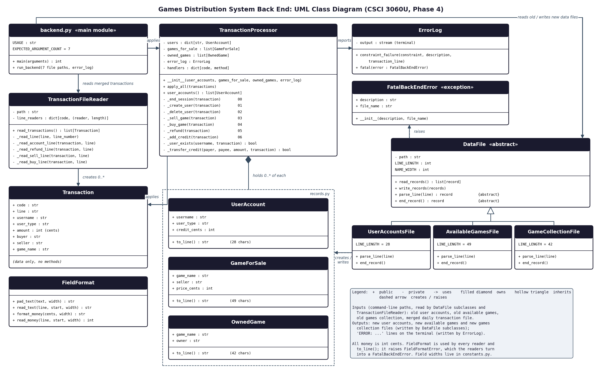

# Games Distribution System

Phase 4 - Back End Design Document (Rapid Prototype)

CSCI 3060U - Fall 2026 - Version 1.0, November 20, 2026

Group: Qudsia Fawad, Diana Riyahi, Dhruv Thakar

# 1. Overview

The Back End is the overnight batch processor of the Games Distribution System. It reads the previous day's Current User Accounts File, Available Games File and Games Collection File, applies every transaction in the Merged Daily Transaction File, and writes new versions of the three files for the next day's Front End sessions. It is written in Python 3 and lives in the `backend/` folder.

**Front End used.** Following the Front End replacement, the team's Back End reads files produced by **Front End A** (from the course's NewFrontEnds3 folder), whose source and test suite are now in the repository's `frontend_a/` folder. Front End A writes every file with the field widths given in the project handout (user names 15 characters, game names 26 characters, credit 9 characters, price 6 characters), so the Back End reads and writes exactly those widths. All widths are kept in one file, `constants.py`, so a change of Front End or of a field width touches only that file.

This is the Phase 4 rapid prototype. It runs on the sample inputs in `backend/sample/`, and on all 147 of Front End A's expected daily transaction files merged into one file, but has not been systematically tested; unit testing is the work of Phase 5.

# 2. How to run

From the repository root, with Python 3.8 or newer:

```text
python backend/backend.py OLD_ACCOUNTS OLD_GAMES OLD_COLLECTION MERGED_TRANSACTIONS NEW_ACCOUNTS NEW_GAMES NEW_COLLECTION
```

Example with the sample files:

```text
python backend/backend.py backend/sample/old_accounts.txt backend/sample/old_games.txt backend/sample/old_collection.txt backend/sample/merged_transactions.txt backend/sample/output/new_accounts.txt backend/sample/output/new_games.txt backend/sample/output/new_collection.txt
```

The program exits with status 0 on success and 1 on a fatal error or wrong arguments.

# 3. Inputs and outputs

| Kind | Item | Format | Handled by |
|---|---|---|---|
| Input file | Old Current User Accounts File | 28-character lines `UUUUUUUUUUUUUUU_TT_CCCCCCCCC`, ends with END | `UserAccountsFile` |
| Input file | Old Available Games File | 49-character lines `IIIIIIIIIIIIIIIIIIIIIIIIII_SSSSSSSSSSSSSSS_PPPPPP`, ends with END | `AvailableGamesFile` |
| Input file | Old Games Collection File | 42-character lines `IIIIIIIIIIIIIIIIIIIIIIIIII_SSSSSSSSSSSSSSS`, ends with END | `GameCollectionFile` |
| Input file | Merged Daily Transaction File | daily transaction lines (codes 00-06), ending with a 00 line | `TransactionFileReader` |
| Output file | New Current User Accounts File | same format as the old file | `UserAccountsFile` |
| Output file | New Available Games File | same format as the old file | `AvailableGamesFile` |
| Output file | New Games Collection File | same format as the old file | `GameCollectionFile` |
| Terminal | Failed constraint log | `ERROR: Failed constraint (<constraint>): <description>. Transaction: '<line>'` | `ErrorLog.constraint_failure` |
| Terminal | Fatal error | `ERROR: Fatal error: <description>. File: <file>` (then the program stops, writing nothing) | `ErrorLog.fatal` |

# 4. Structure of the solution

Each module has one responsibility, and data flows in one direction:

1. `backend.py` (main) checks the arguments and calls `run_backend`.
2. The three `DataFile` subclasses read the old files into record objects (`UserAccount`, `GameForSale`, `OwnedGame`).
3. `TransactionFileReader` reads the merged file into `Transaction` objects.
4. `TransactionProcessor` applies each transaction to the records, reporting failed constraints to `ErrorLog` and skipping those transactions.
5. The same `DataFile` subclasses write the updated records to the new files.

If any input file is bad (wrong line length, unknown transaction code, unreadable money field, missing END or 00 line, missing file), a `FatalBackEndError` is raised, `ErrorLog.fatal` prints it, and the program stops before any output file is written.

All money is held as a whole number of cents to avoid floating-point rounding. Field reading and writing is shared through `FieldFormat`, so every file uses the same padding and money rules. The steps common to all three data files (checking line length, stopping at END, writing the END line) are written once in the `DataFile` base class.

Business constraints enforced (from the handout):

- no user should ever have a negative account balance (checked for buy and refund);
- a newly created user must have a name different from all existing users (checked for create).

A transaction that names a user who does not exist is also reported and skipped, because it cannot be applied.

# 5. UML class diagram



# 6. Classes and methods

| Module | Class / function | Method | Intention (one sentence) |
|---|---|---|---|
| backend.py | (main module) | | Entry point: reads the old files and merged transactions, applies them, and writes the new files. |
| backend.py | | `main(arguments)` | Checks the seven command-line arguments, runs the Back End, reports a fatal error if one occurs, and returns the exit status. |
| backend.py | | `run_backend(...)` | Reads all four input files, applies the transactions with a TransactionProcessor, and writes the three output files. |
| constants.py | (constants) | | Holds every field width, line length, user type code and transaction code in one place. |
| field_format.py | `FieldFormat` | | Reads and writes the fixed-width text and money fields used in every file. |
| field_format.py | `FieldFormat` | `pad_text(text, width)` | Returns text left-justified and padded with spaces to exactly width characters. |
| field_format.py | `FieldFormat` | `read_text(line, start, width)` | Returns the text field at the given columns with its trailing padding removed. |
| field_format.py | `FieldFormat` | `format_money(cents, width)` | Returns cents as a zero-filled dollars-and-cents string of the given width (e.g. 1500 to `015.00`). |
| field_format.py | `FieldFormat` | `read_money(line, start, width)` | Returns the money field at the given columns as cents, raising FieldFormatError if it is not a valid amount. |
| field_format.py | `FieldFormatError` | | Exception raised when a field cannot be read. |
| records.py | `UserAccount` | | One user: username, user type and credit in cents. |
| records.py | `UserAccount` | `to_line()` | Returns the account as a 28-character accounts-file line. |
| records.py | `GameForSale` | | One game for sale: game name, seller and price in cents. |
| records.py | `GameForSale` | `to_line()` | Returns the game as a 49-character available-games-file line. |
| records.py | `OwnedGame` | | One collection entry: a game and the user who owns it. |
| records.py | `OwnedGame` | `to_line()` | Returns the entry as a 42-character collection-file line. |
| data_files.py | `DataFile` | | Abstract base for a fixed-width data file that ends with an END record. |
| data_files.py | `DataFile` | `read_records()` | Reads the file up to its END line and returns its records, raising FatalBackEndError on a bad line or missing END. |
| data_files.py | `DataFile` | `write_records(records)` | Writes each record's line followed by the END line. |
| data_files.py | `DataFile` | `parse_line(line)` | (Abstract) turns one line into a record. |
| data_files.py | `DataFile` | `end_record()` | (Abstract) returns the special END record written last. |
| data_files.py | `UserAccountsFile` | `parse_line(line)` / `end_record()` | Reads one accounts line into a UserAccount (checking the user type) / returns the END user. |
| data_files.py | `AvailableGamesFile` | `parse_line(line)` / `end_record()` | Reads one available-games line into a GameForSale / returns the END game. |
| data_files.py | `GameCollectionFile` | `parse_line(line)` / `end_record()` | Reads one collection line into an OwnedGame / returns the END entry. |
| transactions.py | `Transaction` | | One merged-file line split into named fields (code, username, user type, amount, buyer, seller, game name, original line). |
| transactions.py | `TransactionFileReader` | | Reads the Merged Daily Transaction File into Transaction objects. |
| transactions.py | `TransactionFileReader` | `read_transactions()` | Returns all transactions in order, raising FatalBackEndError if a line is bad or the file does not end with 00. |
| transactions.py | `TransactionFileReader` | `_read_line(line, line_number)` | Checks one line's code and length, then fills a Transaction using the reader for that code. |
| transactions.py | `TransactionFileReader` | `_read_account_line(...)` | Fills username, user type and credit for a 00, 01, 02 or 06 line. |
| transactions.py | `TransactionFileReader` | `_read_refund_line(...)` | Fills buyer, seller and refund amount for a 05 line. |
| transactions.py | `TransactionFileReader` | `_read_sell_line(...)` | Fills game name, seller and price for a 03 line. |
| transactions.py | `TransactionFileReader` | `_read_buy_line(...)` | Fills game name, seller, buyer and price for a 04 line. |
| transaction_processor.py | `TransactionProcessor` | | Holds the in-memory users, games and collections and applies each transaction to them. |
| transaction_processor.py | `TransactionProcessor` | `apply_all(transactions)` | Applies every transaction in order by calling the method for its code. |
| transaction_processor.py | `TransactionProcessor` | `user_accounts()` | Returns the updated list of user accounts. |
| transaction_processor.py | `TransactionProcessor` | `_end_session(t)` | 00: marks the end of a Front End session; nothing changes. |
| transaction_processor.py | `TransactionProcessor` | `_create_user(t)` | 01: adds a new user unless the name is already taken. |
| transaction_processor.py | `TransactionProcessor` | `_delete_user(t)` | 02: removes the user, their games for sale and their collection. |
| transaction_processor.py | `TransactionProcessor` | `_sell_game(t)` | 03: adds the game to the available games. |
| transaction_processor.py | `TransactionProcessor` | `_buy_game(t)` | 04: moves the price from buyer to seller and adds the game to the buyer's collection. |
| transaction_processor.py | `TransactionProcessor` | `_refund(t)` | 05: moves the refund amount from seller to buyer. |
| transaction_processor.py | `TransactionProcessor` | `_add_credit(t)` | 06: adds credit to the user's account. |
| transaction_processor.py | `TransactionProcessor` | `_user_exists(username, t)` | Returns whether the user exists, reporting a failed constraint if not. |
| transaction_processor.py | `TransactionProcessor` | `_transfer_credit(payer, payee, amount, t)` | Moves credit between users unless the payer would go negative, in which case it reports a failed constraint. |
| error_log.py | `ErrorLog` | | Prints errors to the terminal in the required `ERROR: <msg>` form. |
| error_log.py | `ErrorLog` | `constraint_failure(constraint, description, transaction_line)` | Prints a failed-constraint error naming the constraint and the transaction. |
| error_log.py | `ErrorLog` | `fatal(error)` | Prints a fatal error naming the problem and the file. |
| error_log.py | `FatalBackEndError` | | Exception raised when an input file is bad; carries the description and file name. |

# 7. Known limits of this prototype (left for Phase 5)

- Credit is not capped; a balance above 999,999.99 would not fit the 9-character credit field.
- The Back End trusts the Front End for rules it already enforces (user type permissions, unique game names, price and name length limits, the 1000.00 add-credit session limit).
- Game names are not checked for uniqueness across sessions: if two sessions on the same day each sell a game with the same name, the new Available Games File lists it twice.
- No unit tests yet; these are written in Phase 5.
