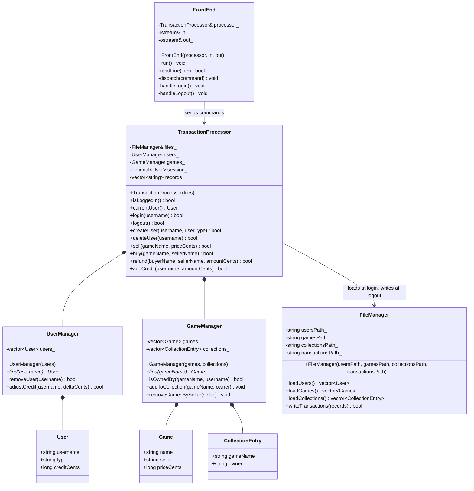

# CSCI 3060U – Phase 2: Front End Design Notes

Status: initial prototype (2026-10-13). Only the command loop, login, logout and
the session and account-type checks work. Everything else is a placeholder.

**Sources**
- Handout: `Project_Docs/Extreme Project - Games Distribution (2026).docx.md`
- Phase 2 assignment: `Project_Docs/2026 CSCI3060U_phase2.docx.md`
- Phase 1 fixtures (`inputs/`, `expected/`) and `Project_Docs/README.txt`

Where the handout and the fixtures disagree, both are shown and the item is
listed in §5. Sections 1–3 are written to feed the Phase 2 design document,
which needs a UML class diagram and a one-sentence description of every class
and method.

## 1. Classes

| Class | Files | Intention |
|---|---|---|
| `FrontEnd` | `include/FrontEnd.h`, `src/FrontEnd.cpp` | Runs the console loop: reads each command, enforces the login and account-type rules, prompts for input and prints results. |
| `TransactionProcessor` | `include/TransactionProcessor.h`, `src/TransactionProcessor.cpp` | Owns the login session and the data read for it, validates and applies transactions, and writes the session's records at logout. |
| `UserManager` | `include/UserManager.h`, `src/UserManager.cpp` | Holds the session's user accounts and looks them up. |
| `GameManager` | `include/GameManager.h`, `src/GameManager.cpp` | Holds the session's available games and game collections and looks them up. |
| `FileManager` | `include/FileManager.h`, `src/FileManager.cpp` | Reads the three input files and writes the Daily Transaction File. |
| `User` | `include/User.h` | Plain data for one account: username, type code (`AA`, `FS`, `BS`, `SS`) and credit. |
| `Game`, `CollectionEntry` | `include/Game.h` | Plain data for one game for sale (name, seller, price), and one game owned by one user. |
| — | `src/main.cpp` | Checks the command-line arguments, wires the objects together and runs `FrontEnd`. |

`User`, `Game` and `CollectionEntry` have no behaviour, so they have no `.cpp`
files. Money is stored as integer cents (`long long`) so that limit checks like
600.00 + 400.01 > 1000.00 (TC42) are exact.

## 2. Methods

| Method | Inputs → output | Intention | State |
|---|---|---|---|
| `FrontEnd(processor, in, out)` | processor, input and output streams | Set up a front end that reads from `in` and writes to `out`. | done |
| `FrontEnd::run` | — | Process commands until the end of input. | done |
| `FrontEnd::readLine` *(private)* | → line, `bool` | Read one input line, dropping a trailing `\r`; false at end of input. | done |
| `FrontEnd::dispatch` *(private)* | command | Apply the session and account-type checks, then run the command. | done (non-login/logout commands print "not implemented") |
| `FrontEnd::handleLogin` *(private)* | — | Prompt for a username and start the session if it is accepted. | done |
| `FrontEnd::handleLogout` *(private)* | — | End the session and report whether the DTF was written. | done |
| `TransactionProcessor(files)` | `FileManager` | Set up a processor that reads and writes through `files`. | done |
| `TransactionProcessor::isLoggedIn` | → `bool` | Report whether a session is active. | done |
| `TransactionProcessor::currentUser` | → `const User&` | Return the logged-in user (throws if none). | done |
| `TransactionProcessor::login` | username → `bool` | Read the users file, check the user exists, then read the games and collections and start the session. Throws if a file can't be read. | done |
| `TransactionProcessor::logout` | → `bool` | Write the session's records and `00` to the DTF and end the session; keep both if the write fails. | done |
| `TransactionProcessor::createUser` | username, type word → `bool` | Validate and record a create (`01`). | **placeholder** (false) |
| `TransactionProcessor::deleteUser` | username → `bool` | Validate, remove the user and their games, record a delete (`02`). | **placeholder** |
| `TransactionProcessor::sell` | game name, price → `bool` | Validate and record a sell (`03`). | **placeholder** |
| `TransactionProcessor::buy` | game name, seller → `bool` | Validate, move credit, add the game to the buyer's collection, record a buy (`04`). | **placeholder** |
| `TransactionProcessor::refund` | buyer, seller, amount → `bool` | Validate, move credit from the seller to the buyer, record a refund (`05`). | **placeholder** |
| `TransactionProcessor::addCredit` | username, amount → `bool` | Validate the per-session limit, add credit, record an addcredit (`06`). | **placeholder** |
| `UserManager(users)` | users list | Take ownership of the users. | done |
| `UserManager::find` | username → `const User*` / `nullptr` | Look up a user by exact name. | done |
| `UserManager::removeUser` | username → `bool` | Remove a user (delete). | **placeholder** (false) |
| `UserManager::adjustCredit` | username, ±cents → `bool` | Change a user's credit (buy, refund, addcredit). | **placeholder** (false) |
| `GameManager(games, collections)` | two lists | Take ownership of the games and collections. | done |
| `GameManager::find` | game name → `const Game*` / `nullptr` | Look up an available game by exact name. | done (list is empty until `loadGames` exists) |
| `GameManager::isOwnedBy` | game, username → `bool` | Check whether a user owns a game. | done (list is empty until `loadCollections` exists) |
| `GameManager::addToCollection` | game, owner | Record a purchase in the buyer's collection. | **placeholder** (no-op) |
| `GameManager::removeGamesBySeller` | seller | Cancel a deleted user's games for sale. | **placeholder** (no-op) |
| `FileManager(4 paths)` | users, games, collections, DTF paths | Store the paths of the files to use. | done |
| `FileManager::loadUsers` | → `vector<User>` | Parse the Current User Accounts File up to `END`; throws on a missing file, a malformed line or a missing `END`. | done |
| `FileManager::loadGames` | → `vector<Game>` | Parse the Available Games File. | **placeholder** (empty), blocked on §5 #2 |
| `FileManager::loadCollections` | → `vector<CollectionEntry>` | Parse the Game Collection File. | **placeholder** (empty), blocked on §5 #3 |
| `FileManager::writeTransactions` | records → `bool` | Overwrite the DTF with the given records, one per line. | done |

`FrontEnd.cpp` also has two file-local helpers: `isKnownCommand` and
`isPermitted`. `FileManager.cpp` has four: `isDigits`, `parseCents`,
`trimRight` and `isUserType`.

## 3. Structure



Where the inputs and outputs fit:

```text
 users file ─┐                       ┌─ at login: loadUsers() → UserManager
 games file ─┼─► FileManager ◄───────┤  after username accepted: loadGames(), loadCollections() → GameManager
 coll. file ─┘        │              └─ at logout: writeTransactions(records + "00")
                      ▼
             Daily Transaction File            TransactionProcessor
                                                       ▲
 stdin (commands, fields) ─► FrontEnd ─────────────────┘
 stdout ◄─ prompts, results ─┘
```

How `FrontEnd::dispatch` handles a command, in order:

1. Unknown command → error (TC44).
2. `login` → rejected if someone is already logged in (TC04); otherwise prompt for a username (TC01, TC02).
3. Any other command while logged out → error (TC03, TC06, TC07).
4. `logout` → write the DTF (TC05, TC45).
5. Account type not allowed → error (TC09, TC14, TC18, TC27, TC33).
6. Otherwise → "not implemented yet; nothing was recorded".

Account-type rules (`isPermitted`), all from the handout's Transaction Code Details:

| Command | Allowed for | Handout wording |
|---|---|---|
| `create`, `delete`, `refund` | `AA` | "privileged transaction" |
| `sell` | `AA`, `FS`, `SS` | "any type of account except standard-buy" |
| `buy` | `AA`, `FS`, `BS` | "any type of account except standard-sell" |
| `addcredit` | all | unprivileged |

Session and account-type rejections happen before any field is prompted for.
TC04, TC09, TC18 and TC27 show this: the line that follows the rejected
command is a new command.

## 4. Input and output files

Run as `games-distribution <users-file> <games-file> <collections-file> <daily-transaction-file>`,
with the transaction stream on standard input. **Passing the paths as
arguments is our choice.** The handout only says the program is a console
application that uses text files.

When files are read (handout, login): the user accounts file is read before
the login is processed, and the available games file only after the username is
accepted. The code reads the collections file at the same point as the games
file (see §5 #8).

### Data files

Fields are left-justified and padded with spaces; money is zero-padded with
cents, e.g. `005000.00`. Each file ends with an `END` record.

| File | Handout | Phase 1 fixtures | Code |
|---|---|---|---|
| Current User Accounts | 28 chars: `UUUUUUUUUUUUUUU_TT_CCCCCCCCC` (name 15, type 2, credit 9) | 28, same | parsed by `loadUsers` |
| Available Games | heading 49; template `I×26_S×15_P×6` = 49; constraint says "exactly 42" | 48: name **25**, seller 15, price 6 | not parsed |
| Game Collection | 42: `I×26_S×15` | 41: name **25**, owner 15 | not parsed |

### Transaction input (stdin)

One item per line: the command, then its fields. The handout and the fixtures
agree on this order.

| Command | Field lines after the command |
|---|---|
| `login` | username |
| `logout` | — |
| `create` | new username, then user type: `admin`, `full-standard`, `buy-standard` or `sell-standard` |
| `delete` | username |
| `sell` | game name, then price in dollars (e.g. `15.00`) |
| `buy` | game name, then seller's username |
| `refund` | buyer's username, seller's username, amount |
| `addcredit` | amount; then username, **only when logged in as admin** |

### Daily Transaction File (output)

| Code | Handout template (width) | Phase 1 fixtures (width) |
|---|---|---|
| `01` create | `XX_U×15_TT_C×9` (31), C = available credit | same (31); credit `000000.00` |
| `02` delete | `XX_U×15_TT_C×9` (31) | type blank, credit `000000.00` (TC13) |
| `06` addcredit | `XX_U×15_TT_C×9` (31), C = "available credit" | same layout; C = **amount added** (TC41) |
| `00` end of session | `XX_U×15_TT_C×9` (31) | bare `00` (2) |
| `05` refund | `XX_U×15_S×15_C×9` (44), buyer, seller, amount | same (44) |
| `03` sell | `XX_I×19_S×13_P×6` (43) | name 25, seller 15, price 6 (51) |
| `04` buy | `XX_I×19_S×15_U×14_P×6` (60), game, seller, buyer, price | 25, 15, 15, 6 (67) |

Only `00` is written today, as a bare `00` to match the fixtures (marked
`TODO(verify)` in `TransactionProcessor::logout`). At each logout the file is
**overwritten** with that session's records followed by `00` (see §5 #10).

## 5. Ambiguities and open questions

### Answered by the handout (were open in the first draft)

- Account types allowed for `sell`, `buy` and `addcredit` (§3 table).
- Admin `addcredit` reads the amount first, then the username.
- `create` type words: `admin`, `full-standard`, `buy-standard`, `sell-standard`.
- Transactions take effect for the rest of the session. A buy moves credit and adds the game to the buyer's collection. A refund moves credit. A delete cancels the user's games for sale and blocks further transactions on them. Only a sold game waits until the next session.
- When the files are read (§4). The code originally read everything at startup; it now follows the handout.

### Still open

TA = needs an answer from the TA/client. Group = our decision.

| # | Issue | Current behaviour | Who |
|---|---|---|---|
| 1 | **`00` record format.** The handout template gives `00` the 31-char user layout, but the Merged DTF section says "just a line with a 00 transaction code", and our fixtures write a bare `00`. If the template applies, which username, type and credit go in it? | Writes bare `00` | TA |
| 2 | **Available Games File width.** The heading and template say 49, the constraint says 42, the fixtures use 48. *Inference:* "42" looks copied from the collection-file section, since the heading and template agree on 49. | Not parsed | TA |
| 3 | **Game Collection File width.** The handout says 42 (26-char name); our fixtures use 41 (25-char name). If the handout is right, all 46 `*.collection.txt` (and probably `*.game.txt`) fixtures need one more space in the name field. | Not parsed | TA, then group |
| 4 | **Sell/buy DTF widths.** The templates use a 19-char game name and 13- or 14-char usernames, which can't hold the 25-char game names and 15-char usernames the handout allows. The fixtures use 25 and 15. | Not written | TA |
| 5 | Delete record: the template says type and available credit; fixture TC13 has a blank type and `000000.00`. | Not written | TA |
| 6 | Addcredit record: the template's credit field is "available credit" (the balance after?), while the fixtures record the amount added. | Not written | TA |
| 7 | `create` lists "maximum credit can be 999,999" but never asks for a credit amount. What does it limit? New users get `000000.00` in the fixtures. | Not written | TA |
| 8 | The handout lists only the users and games files as Front End inputs, but `buy` must check the buyer's collection. | Collections file taken as an argument and read at login | TA |
| 9 | Can a user created this session be used in the same session (refund to them, add credit, delete)? | — | TA |
| 10 | Several sessions in one run: does each logout overwrite the DTF, append to it, or write a separate file? TC07 has two sessions but expects a single `00`. | Overwrites (matches TC07) | TA |
| 11 | Input ends without a logout. | Nothing written | TA |
| 12 | Money input: the handout gives `15.00` as the example. Are `15`, `15.5`, `$15` or negative values valid? | Not parsed yet | TA |
| 13 | When a field is invalid (e.g. a 26-char game name), is it rejected straight away or only after all fields are read? The fixtures always supply every field. | — | Group |
| 14 | **TC25 doesn't isolate what it claims to test.** It uses `seller1` (`SS`) to buy, which the handout forbids, so the buy fails on account type before the "new game" rule is checked. It also has a seller buying their own game. | — | Group: rewrite TC25 with a user allowed to buy |
| 15 | Console prompt and message wording isn't prescribed. | Placeholder wording | Group |
| 16 | Line endings: the fixtures are CRLF; on Linux the program writes LF. | Compare with `diff --strip-trailing-cr` | Group |
| 17 | The Phase 1 test plan's text says `tests/inputs`, `tests/expected`, `tests/actual`, but the repo uses `inputs/` and `expected/` at the root. | Unchanged | Group |
| 18 | Names are matched case-sensitively, exactly as typed. | Exact match | TA |

## 6. Placeholders still to implement

- `FileManager::loadGames` and `loadCollections`: blocked on §5 #2–3.
- `TransactionProcessor::createUser`, `deleteUser`, `sell`, `buy`, `refund`, `addCredit`, including the DTF record formatting (§5 #1, #4–7).
- `UserManager::removeUser`, `adjustCredit`; `GameManager::addToCollection`, `removeGamesBySeller`.
- `FrontEnd::dispatch` placeholder branch: prompt for each command's fields (§4), parse amounts, call the matching `TransactionProcessor` method and print the result. Until this is done, the field lines after a permitted command are read as (unrecognized) commands.
- Session tracking still to add: credit added per account (TC39–TC42), games listed this session (TC25), and deleted users' games.
- Test runner scripts (`run_tests.sh` / `run_tests.bat`), as planned in the Phase 1 test plan.

### Fixture status on 2026-10-13

All 46 fixtures were run. 30 produce the expected DTF and 16 don't. The 16 are
exactly the tests that expect a `01`–`06` record (TC08, 12, 13, 17, 19, 21, 25,
26, 30, 32, 36, 37, 39, 41, 42, 46), as expected while those transactions are
placeholders. Of the 30 matches, only the session tests (TC01–TC07, TC44, TC45)
show real behaviour. The rest expect only `00`, so they match because nothing
is recorded yet, not because the validation works.
